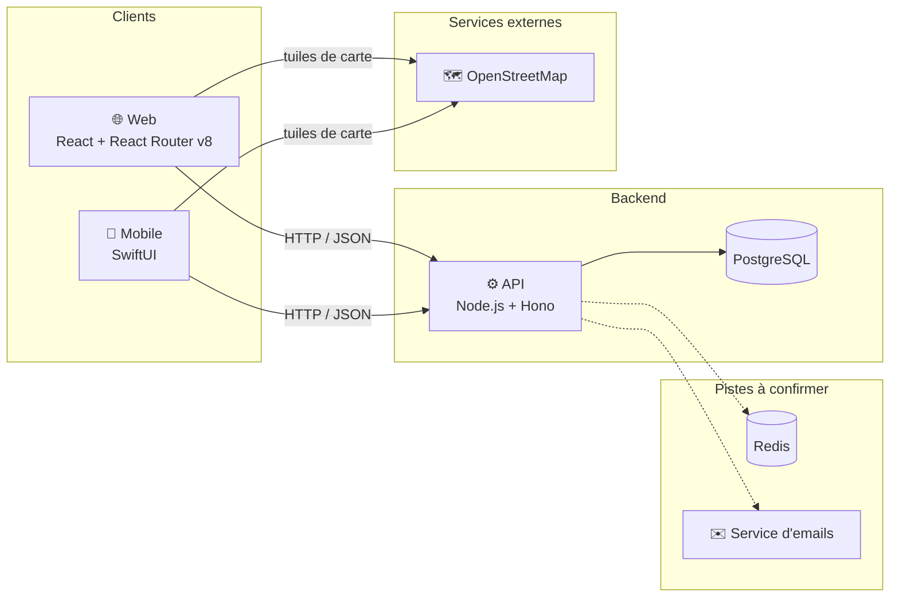
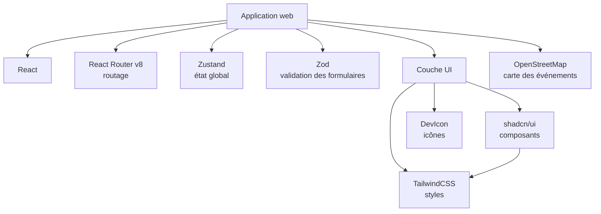
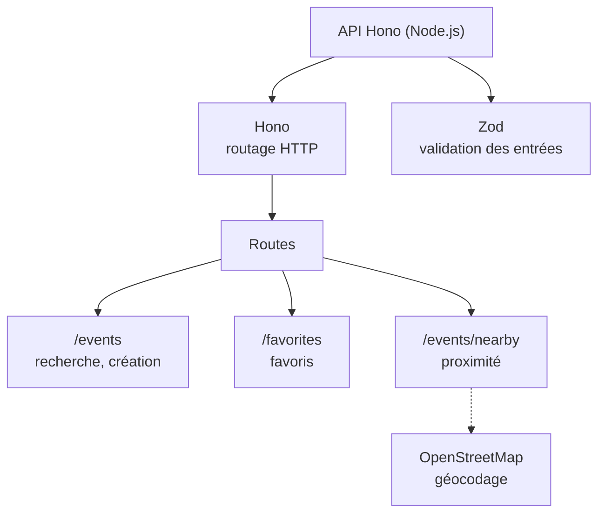
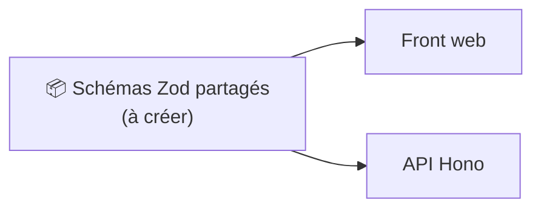
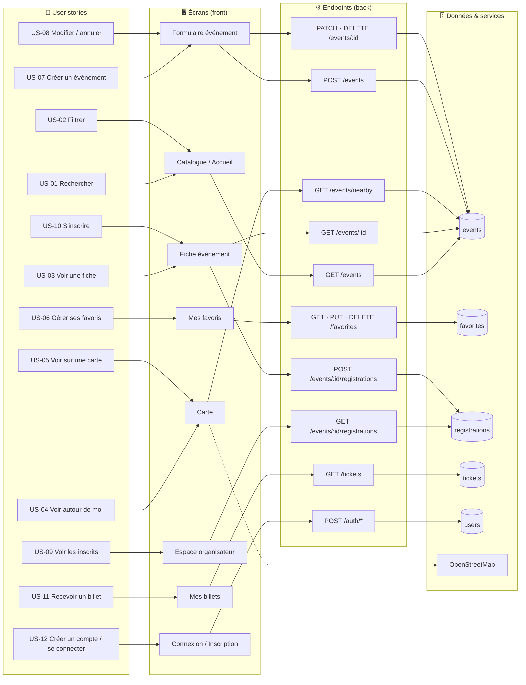

<div align="center">

# 🎟️ EventHub

**La plateforme qui révolutionne la gestion d'événements.**

Recherchez, créez et suivez des événements près de chez vous, sur le web comme sur mobile.


</div>

---

## 📖 Histoire

On en avait marre des événements mal organisés. C'est pourquoi nous avons créé **EventHub** : une application qui centralise la découverte, la création et la gestion d'événements, avec les inscriptions, les quotas et les billets à QR code.

## ✨ Fonctionnalités principales

| Fonctionnalité | Description |
| --- | --- |
| 🔍 **Recherche d'événements** | Catalogue filtrable (titre, catégorie, date, lieu). |
| ➕ **Création d'événements** | Espace organisateur pour publier et gérer ses événements. |
| 📍 **Événements à proximité** | Suggestions géolocalisées avec vue sur carte (OpenStreetMap). |
| ⭐ **Favoris** | Sauvegarde des événements qui nous intéressent. |

### Fonctionnalités de coordination (prévues)

- Gestion des inscriptions et des quotas de places
- Prévention des doubles réservations
- Génération de billets avec QR code
- Envoi d'emails de confirmation

---

## 🧱 Stack technique

| Couche | Technologies |
| --- | --- |
| **Web (front)** | React, React Router v8, Zod, Zustand, shadcn/ui, DevIcon, TailwindCSS |
| **Back** | Node.js, Hono, Zod |
| **Mobile** | SwiftUI (`apps/native`) |
| **Base de données** | PostgreSQL (`packages/db`) |
| **Services externes** | OpenStreetMap |
| **Outillage** | Bun, Vite+, Docker Compose, Dev Container, GitHub Actions, Gitleaks, Fumadocs, Ruler |
| **Pistes à confirmer** | Redis (verrous de places / cache), service d'emails |

---

## 🗺️ Carte des dépendances

### Vue d'ensemble de l'architecture



> Les flèches pleines sont les dépendances actuelles ; les flèches en pointillés sont des pistes encore à valider.

### Dépendances du front web



### Dépendances du back



### Schéma partagé (Zod)

Zod est utilisé des deux côtés : idéalement, les schémas sont définis une seule fois et partagés entre le front et le back pour garantir que les contrats d'API restent synchronisés.



### Carte User story → Écran → Endpoint

> Les écrans et endpoints ci-dessous sont une **proposition de conception** : ils ne correspondent pas encore à du code existant. Les écrans valent pour le web (React Router) et le mobile (SwiftUI).



| ID | User story | Écran (front) | Endpoint (back) | Données |
| --- | --- | --- | --- | --- |
| US-01 | Rechercher un événement par mot-clé | Catalogue / Accueil | `GET /events?q=` | `events` |
| US-02 | Filtrer par catégorie, date, lieu | Catalogue / Accueil | `GET /events?category=&date=&city=` | `events` |
| US-03 | Consulter la fiche d'un événement | Fiche événement | `GET /events/:id` | `events` |
| US-04 | Voir les événements proches de moi | Carte | `GET /events/nearby?lat=&lng=&radius=` | `events` |
| US-05 | Afficher les événements sur une carte | Carte | `GET /events/nearby` + tuiles OpenStreetMap | `events` |
| US-06 | Ajouter, retirer, consulter ses favoris | Mes favoris (+ bouton ⭐ sur la fiche) | `GET /favorites`, `PUT /favorites/:eventId`, `DELETE /favorites/:eventId` | `favorites` |
| US-07 | Créer un événement | Formulaire événement | `POST /events` | `events` |
| US-08 | Modifier ou annuler son événement | Formulaire événement | `PATCH /events/:id`, `DELETE /events/:id` | `events` |
| US-09 | Voir la liste des inscrits | Espace organisateur | `GET /events/:id/registrations` | `registrations` |
| US-10 | S'inscrire à un événement *(prévu)* | Fiche événement | `POST /events/:id/registrations` | `registrations`, `events` (quota) |
| US-11 | Recevoir un billet QR code *(prévu)* | Mes billets | `GET /tickets`, `GET /tickets/:id` | `tickets` |
| US-12 | Créer un compte et se connecter | Connexion / Inscription | `POST /auth/*` | `users` |

**Règles transverses côté back** : toute écriture (`POST`, `PATCH`, `PUT`, `DELETE`) exige un utilisateur connecté ; `PATCH`/`DELETE /events/:id` et `GET /events/:id/registrations` sont réservés à l'organisateur de l'événement ; `POST /events/:id/registrations` vérifie le quota et refuse les doublons (contrainte d'unicité `user + event`).

---

## 👥 User stories

### 🔍 Recherche d'événements

- En tant que **visiteur**, je veux rechercher un événement par mot-clé afin de trouver rapidement ce qui m'intéresse.
- En tant que **visiteur**, je veux filtrer les événements par catégorie, date et lieu afin d'affiner mes résultats.
- En tant que **visiteur**, je veux consulter la fiche détaillée d'un événement afin de décider si j'y participe.

### 📍 Événements à proximité

- En tant qu'**utilisateur**, je veux voir les événements proches de moi afin de découvrir ce qui se passe autour de moi.
- En tant qu'**utilisateur**, je veux afficher les événements sur une carte afin de visualiser leur emplacement.
- En tant qu'**utilisateur**, je veux ajuster le rayon de recherche afin de contrôler la distance maximale.

### ⭐ Favoris

- En tant qu'**utilisateur connecté**, je veux ajouter un événement à mes favoris afin de le retrouver plus tard.
- En tant qu'**utilisateur connecté**, je veux retirer un événement de mes favoris afin de garder une liste pertinente.
- En tant qu'**utilisateur connecté**, je veux consulter la liste de mes favoris afin d'y accéder en un clic.

### ➕ Création et gestion d'événements

- En tant qu'**organisateur**, je veux créer un événement (titre, description, date, lieu, capacité) afin de le rendre visible.
- En tant qu'**organisateur**, je veux placer le lieu de l'événement sur une carte afin que les participants le localisent facilement.
- En tant qu'**organisateur**, je veux modifier ou annuler mon événement afin de garder les informations à jour.
- En tant qu'**organisateur**, je veux voir la liste des inscrits afin de suivre la fréquentation.

### 🎫 Inscriptions et billets (prévu)

- En tant que **participant**, je veux m'inscrire à un événement afin de réserver ma place.
- En tant que **participant**, je veux recevoir un billet avec QR code afin de l'utiliser à l'entrée.
- En tant que **participant**, je veux recevoir un email de confirmation afin d'avoir une trace de mon inscription.
- En tant que **système**, je veux empêcher les doubles réservations et le dépassement de quota afin de garantir l'intégrité des places.

### 👤 Compte

- En tant que **visiteur**, je veux créer un compte et me connecter afin d'accéder aux fonctions personnalisées.

---

## 🚀 Démarrage

### Prérequis

- [Bun](https://bun.sh) pour les dépendances JavaScript (installées à la racine du workspace)
- Pour l'app mobile : macOS, Xcode et [XcodeGen](https://github.com/yonaskolb/XcodeGen)
- Docker (optionnel) pour lancer PostgreSQL via Docker Compose ou le Dev Container

### Installation

```bash
git clone https://github.com/<votre-compte>/eventhub.git
cd eventhub

bun install
(cd apps/native && xcodegen generate)
```

Copiez ensuite le `.env.example` de chaque application en `.env` (quand il existe) et renseignez les identifiants de la base de données avant de démarrer les services qui en dépendent.

### Développement

Lance ensemble le front web et le back (si l'un s'arrête, les autres sont arrêtés) :

```bash
bun run dev
```

L'application mobile se lance séparément, pour choisir un simulateur ou un appareil :

```bash
cd apps/native && open BetterFullstackApp.xcodeproj
```

Le web et le mobile communiquent avec l'API en HTTP. Voir le README et le fichier d'environnement de chaque application pour son endpoint local.

## 🗂️ Structure du projet

```text
eventhub/
├── apps/
│   ├── web/        # React + React Router
│   ├── server/     # Node.js + Hono
│   └── native/     # SwiftUI (iOS)
├── packages/
│   └── db/         # PostgreSQL
└── README.md
```

> Le projet a été généré avec [Better Fullstack](https://github.com/Marve10s/Better-Fullstack). Les schémas Zod partagés (`packages/schemas`) restent une piste à créer.

## 🛣️ Feuille de route

- [ ] Recherche et catalogue d'événements
- [ ] Création d'événements
- [ ] Vue carte et événements à proximité
- [ ] Favoris
- [ ] Inscriptions, quotas et billets QR code
- [ ] Emails de confirmation
- [ ] Application mobile

## 🤝 Contribuer

Les contributions sont les bienvenues. Ouvrez une *issue* pour discuter d'un changement, puis soumettez une *pull request*.

## 🙏 Crédits

- Cartographie : © les contributeurs [OpenStreetMap](https://www.openstreetmap.org/copyright)

## 📄 Licence

À définir.
