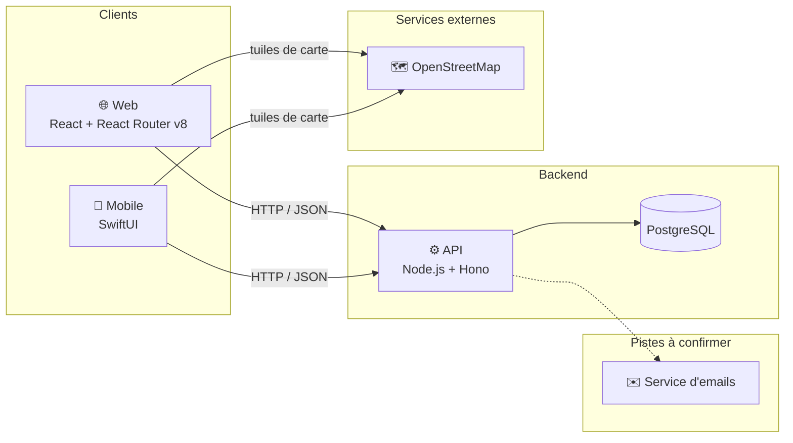
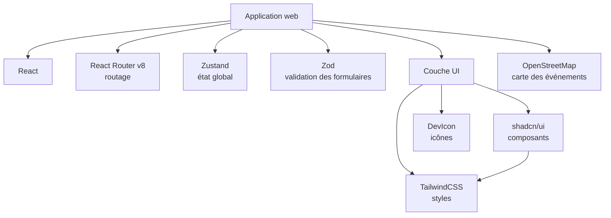
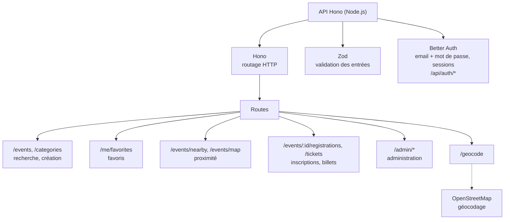
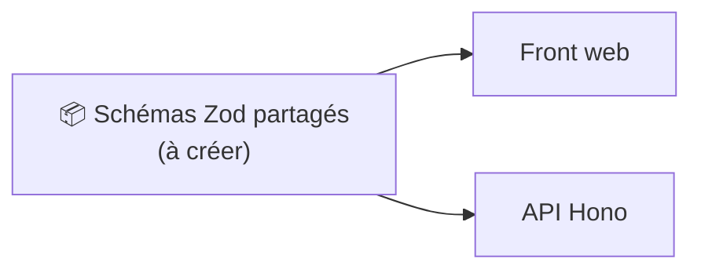
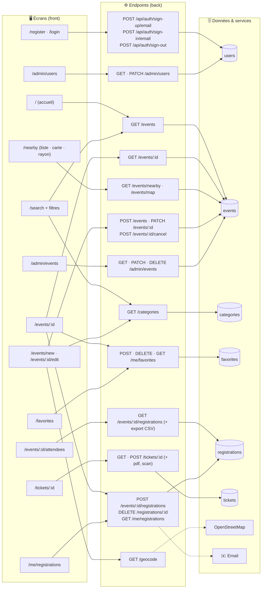

<div align="center">

# 🎟️ EventHub

**La plateforme qui révolutionne la gestion d'événements.**

Recherchez, créez et suivez des événements près de chez vous, sur le web comme sur mobile.


</div>

---

## 📖 Histoire

On en avait marre des événements mal organisés. C'est pourquoi nous avons créé **EventHub** : une application qui centralise la découverte, la création et la gestion d'événements, avec les inscriptions, les quotas et les billets à QR code.

## ✨ Fonctionnalités principales

| Fonctionnalité                | Description                                                   |
| ----------------------------- | ------------------------------------------------------------- |
| 🔍 **Recherche d'événements** | Catalogue filtrable (titre, catégorie, date, lieu).           |
| ➕ **Création d'événements**  | Espace organisateur pour publier et gérer ses événements.     |
| 📍 **Événements à proximité** | Suggestions géolocalisées avec vue sur carte (OpenStreetMap). |
| ⭐ **Favoris**                | Sauvegarde des événements qui nous intéressent.               |

### Fonctionnalités de coordination (prévues)

- Gestion des inscriptions et des quotas de places
- Prévention des doubles réservations
- Génération de billets avec QR code
- Envoi d'emails de confirmation

---

## 🧱 Stack technique

| Couche                 | Technologies                                                          |
| ---------------------- | --------------------------------------------------------------------- |
| **Web (front)**        | React, React Router v8, Zod, Zustand, shadcn/ui, DevIcon, TailwindCSS |
| **Back**               | Node.js, Hono, Zod, Better Auth (authentification)                    |
| **Mobile**             | SwiftUI (`apps/native`)                                               |
| **Base de données**    | PostgreSQL (`packages/db`)                                            |
| **Services externes**  | OpenStreetMap                                                         |
| **Outillage**          | Bun, Vite+, Docker Compose, GitHub Actions, Gitleaks, Fumadocs, Ruler |
| **Pistes à confirmer** | Usage exact de Redis (verrous de places, cache), service d'emails     |

---

## 🗺️ Carte des dépendances

### Vue d'ensemble de l'architecture



> Les flèches pleines sont les dépendances actuelles ; les flèches en pointillés sont des pistes encore à valider.

### Dépendances du front web



### Dépendances du back



### Schéma partagé (Zod)

Zod est utilisé des deux côtés : idéalement, les schémas sont définis une seule fois et partagés entre le front et le back pour garantir que les contrats d'API restent synchronisés.



### Carte User story → Écran → Endpoint

> Les écrans valent pour le web (React Router) et le mobile (SwiftUI). Les endpoints sont une **proposition de conception** : seule l'authentification (`/api/auth/*`, gérée par Better Auth avec email + mot de passe) existe déjà dans `apps/server`. Le serveur expose aussi un routeur tRPC sur `/trpc/*`, à arbitrer avec cette API REST.
>
> Les rôles `admin` et `organisateur` ne sont pas encore modélisés dans le schéma Prisma : les pages `/admin/*` supposent d'ajouter un champ `role` (ou le plugin `admin` de Better Auth).



> Les flèches en pointillés sont des services externes ou à confirmer (`/geocode` → OpenStreetMap, email → service d'emails).

| ID    | User story                                            | Écran (front)                                           | Endpoint(s) (back)                                                                                                     |
| ----- | ----------------------------------------------------- | ------------------------------------------------------- | ---------------------------------------------------------------------------------------------------------------------- |
| US-01 | Créer un compte, se connecter, se déconnecter         | Pages « Register » et « Login »                         | `POST /api/auth/sign-up/email`, `POST /api/auth/sign-in/email`, `POST /api/auth/sign-out`, `GET /api/auth/get-session` |
| US-02 | Parcourir les événements à l'accueil                  | Page `/`                                                | `GET /events`                                                                                                          |
| US-03 | _(Admin)_ Gérer les utilisateurs                      | Page `/admin/users`                                     | `GET /admin/users`, `PATCH /admin/users/:id`                                                                           |
| US-04 | _(Admin)_ Modérer les événements                      | Page `/admin/events`                                    | `GET /admin/events`, `PATCH /admin/events/:id`, `DELETE /admin/events/:id`                                             |
| US-05 | Rechercher un événement par mot-clé                   | Barre de recherche (header), page `/search`             | `GET /events?q=`                                                                                                       |
| US-06 | Filtrer par catégorie, dates et ville                 | Page `/search` (panneau filtres)                        | `GET /events?category=&from=&to=&city=`, `GET /categories`                                                             |
| US-07 | Consulter la fiche d'un événement                     | Page `/events/:id`                                      | `GET /events/:id`                                                                                                      |
| US-08 | Voir les événements proches de moi (liste)            | Page `/nearby` (vue liste)                              | `GET /events/nearby?lat=&lng=&radius=`                                                                                 |
| US-09 | Voir les événements sur une carte                     | Page `/nearby` (vue carte)                              | `GET /events/map?bbox=`                                                                                                |
| US-10 | Ajuster le rayon de recherche                         | Page `/nearby` (curseur rayon)                          | `GET /events/nearby?radius=` (même endpoint)                                                                           |
| US-11 | Ajouter un événement aux favoris                      | Bouton favori (carte + fiche)                           | `POST /me/favorites/:eventId`                                                                                          |
| US-12 | Retirer un événement des favoris                      | Bouton favori, page `/favorites`                        | `DELETE /me/favorites/:eventId`                                                                                        |
| US-13 | Consulter mes favoris                                 | Page `/favorites`                                       | `GET /me/favorites`                                                                                                    |
| US-14 | Créer un événement                                    | Page `/events/new`                                      | `POST /events`, `GET /categories`                                                                                      |
| US-15 | Choisir le lieu de l'événement                        | Page `/events/new` (sélecteur de lieu)                  | `GET /geocode?q=`                                                                                                      |
| US-16 | Modifier ou annuler mon événement                     | Page `/events/:id/edit`                                 | `PATCH /events/:id`, `POST /events/:id/cancel`                                                                         |
| US-17 | Voir et exporter la liste des inscrits                | Page `/events/:id/attendees`                            | `GET /events/:id/registrations`, `GET /events/:id/registrations/export` (CSV)                                          |
| US-18 | S'inscrire, se désinscrire, voir mes inscriptions     | Bouton « S'inscrire » (fiche), page `/me/registrations` | `POST /events/:id/registrations`, `DELETE /registrations/:id`, `GET /me/registrations`                                 |
| US-19 | Obtenir et faire scanner mon billet QR code           | Page `/tickets/:id`                                     | `GET /tickets/:id`, `GET /tickets/:id/pdf`, `POST /tickets/:id/scan`                                                   |
| US-20 | _(Système)_ Envoyer un email de confirmation          | Aucun (email)                                           | Déclenché par `POST /events/:id/registrations`                                                                         |
| US-21 | _(Système)_ Empêcher doublons et dépassement de quota | Aucun (règle back)                                      | `POST /events/:id/registrations` (contrainte unique + verrou de capacité)                                              |

---

## 👥 User stories

### 🔍 Recherche d'événements

- En tant que **visiteur**, je veux rechercher un événement par mot-clé afin de trouver rapidement ce qui m'intéresse.
- En tant que **visiteur**, je veux filtrer les événements par catégorie, date et lieu afin d'affiner mes résultats.
- En tant que **visiteur**, je veux consulter la fiche détaillée d'un événement afin de décider si j'y participe.

### 📍 Événements à proximité

- En tant qu'**utilisateur**, je veux voir les événements proches de moi afin de découvrir ce qui se passe autour de moi.
- En tant qu'**utilisateur**, je veux afficher les événements sur une carte afin de visualiser leur emplacement.
- En tant qu'**utilisateur**, je veux ajuster le rayon de recherche afin de contrôler la distance maximale.

### ⭐ Favoris

- En tant qu'**utilisateur connecté**, je veux ajouter un événement à mes favoris afin de le retrouver plus tard.
- En tant qu'**utilisateur connecté**, je veux retirer un événement de mes favoris afin de garder une liste pertinente.
- En tant qu'**utilisateur connecté**, je veux consulter la liste de mes favoris afin d'y accéder en un clic.

### ➕ Création et gestion d'événements

- En tant qu'**organisateur**, je veux créer un événement (titre, description, date, lieu, capacité) afin de le rendre visible.
- En tant qu'**organisateur**, je veux placer le lieu de l'événement sur une carte afin que les participants le localisent facilement.
- En tant qu'**organisateur**, je veux modifier ou annuler mon événement afin de garder les informations à jour.
- En tant qu'**organisateur**, je veux voir la liste des inscrits afin de suivre la fréquentation.

### 🎫 Inscriptions et billets (prévu)

- En tant que **participant**, je veux m'inscrire à un événement afin de réserver ma place.
- En tant que **participant**, je veux recevoir un billet avec QR code afin de l'utiliser à l'entrée.
- En tant que **participant**, je veux recevoir un email de confirmation afin d'avoir une trace de mon inscription.
- En tant que **système**, je veux empêcher les doubles réservations et le dépassement de quota afin de garantir l'intégrité des places.

### 🛠️ Administration

- En tant qu'**administrateur**, je veux gérer les utilisateurs afin de contrôler les accès à la plateforme.
- En tant qu'**administrateur**, je veux modérer les événements (modifier, supprimer) afin de garder un catalogue de qualité.

### 👤 Compte

- En tant que **visiteur**, je veux créer un compte et me connecter afin d'accéder aux fonctions personnalisées.

---

## 🚀 Démarrage

### Prérequis

- [Bun](https://bun.sh) 1.3 ou plus récent
- [Docker Desktop](https://www.docker.com/products/docker-desktop/) pour la base PostgreSQL locale
- Git
- Pour l'app mobile uniquement : macOS, Xcode et [XcodeGen](https://github.com/yonaskolb/XcodeGen)

Sous Windows, désactivez la conversion des fins de ligne pour ce dépôt **avant** de travailler dessus, sinon le hook de pre-commit refuse des fichiers que vous n'avez pas modifiés :

```bash
git config core.autocrlf false
```

### 1. Installer

```bash
git clone https://github.com/RobinSartini/EventsHub.git
cd EventsHub
bun install
```

### 2. Lancer

Docker Desktop doit être démarré, puis :

```bash
bun dev
```

Cette commande fait tout, à chaque lancement :

1. crée `apps/server/.env` à partir de `apps/server/.env.example` s'il n'existe pas (les valeurs par défaut fonctionnent en local) ;
2. démarre PostgreSQL dans Docker (port 5432) et attend qu'il soit prêt ;
3. applique le schéma Prisma à la base ;
4. ajoute les données de démonstration (4 catégories, 30 événements) si la base ne contient aucun événement ;
5. lance le front web, l'API et la documentation.

| Service       | URL                   |
| ------------- | --------------------- |
| Front web     | http://localhost:5173 |
| API           | http://localhost:3000 |
| Documentation | http://localhost:4000 |

### 3. Devenir administrateur

Les pages et routes `/admin/*` sont réservées aux administrateurs. Pour passer votre compte admin :

1. Créez un compte depuis le front web.
2. Lancez `bun db:studio`, ouvrez la table `user`, passez le champ `role` de votre compte à `admin` et enregistrez.
3. Déconnectez-vous puis reconnectez-vous.

### Tests et qualité

```bash
bun run test
bun run check
bun run check-types
```

Dans l'ordre : tous les tests, le lint et le formatage (comme le hook de pre-commit), puis le typage TypeScript. Utilisez bien `bun run test` et non `bun test`, qui lance un autre runner que Vitest.

Les tests du back simulent la base de données : Docker n'est pas nécessaire pour les lancer.

### Commandes de la base

| Commande        | Effet                                                        |
| --------------- | ------------------------------------------------------------ |
| `bun db:start`  | Démarre PostgreSQL en arrière-plan et attend qu'il soit prêt |
| `bun db:stop`   | Arrête PostgreSQL en gardant les données                     |
| `bun db:down`   | Supprime le conteneur (les données restent dans le volume)   |
| `bun db:push`   | Applique le schéma Prisma à la base                          |
| `bun db:seed`   | Remplace les événements de démonstration par des neufs       |
| `bun db:studio` | Ouvre Prisma Studio pour consulter et modifier les données   |

### App mobile (macOS)

```bash
cd apps/native
xcodegen generate
open EventsHub.xcodeproj
```

En Debug, l'app appelle un serveur mock généré à partir du contrat d'API, sur le port 4010. Lancez-le depuis la racine du dépôt avant l'app :

```bash
npx @stoplight/prism-cli mock contrat/openapi.yaml -p 4010
```

Pour un appareil physique, voir [`apps/native/README.md`](apps/native/README.md).

## 🗂️ Structure du projet

```text
eventhub/
├── apps/
│   ├── web/        # React + React Router
│   ├── server/     # Node.js + Hono
│   └── native/     # SwiftUI (iOS)
├── packages/
│   └── db/         # PostgreSQL
└── README.md
```

> Le projet a été généré avec [Better Fullstack](https://github.com/Marve10s/Better-Fullstack). Les schémas Zod partagés (`packages/schemas`) restent une piste à créer.

## 🛣️ Feuille de route

- [ ] Recherche et catalogue d'événements
- [ ] Création d'événements
- [ ] Vue carte et événements à proximité
- [ ] Favoris
- [ ] Inscriptions, quotas et billets QR code
- [ ] Emails de confirmation
- [ ] Application mobile

## 🤝 Contribuer

Les contributions sont les bienvenues. Ouvrez une _issue_ pour discuter d'un changement, puis soumettez une _pull request_. Consultez le [guide de contribution](CONTRIBUTING.md) pour les conventions de branches, de commits et d'API.

## 🙏 Crédits

- Cartographie : © les contributeurs [OpenStreetMap](https://www.openstreetmap.org/copyright)

## 📄 Licence

À définir.
